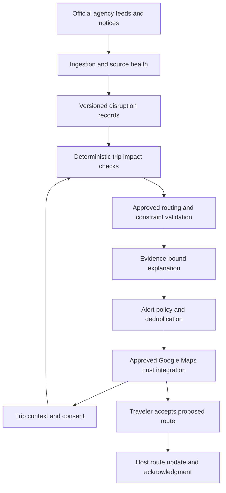

# Event-day integrations and MCP plan

**Status:** Requirements complete for review; connections are proposed, not provisioned.  
**Companion:** [Product requirements](../PRD.md).  
**Target:** An approved native Google Maps feature with no separate traveler download.

## 1. What MCP does here

MCP gives an authorized agent a defined way to call tools. It does not create access to Google Maps UI, obtain location permission, continuously poll feeds, or deliver notifications by itself. Background ingestion and subscriptions require backend workers and an event queue. Use direct APIs for deterministic ingestion; expose selected capabilities through MCP when an agent needs them.

Except for the official Google Maps MCP described below, MCP names in this document are **proposed custom adapters**, not claims that an official agency MCP exists. No connector has been activated by writing this plan. A Maps API key alone does not enable every API, establish a native integration, or authorize another provider.

## 2. Complete connection inventory for the proposed scope

“Required” means required before claiming that category of live coverage. If a source is unavailable, mark that coverage unavailable or narrow the release; do not substitute fabricated events. Independent capabilities may share one deployed MCP server.

| Connection | Source and verified interface | Proposed capability | Priority and implementation state |
| --- | --- | --- | --- |
| Google Maps native host adapter | Supported Google partner/internal interface must be established; no public consumer-app extension interface was verified in this research | Receive consented trip/progress changes, present inline cards, notify, apply accepted route changes | **Blocking dependency.** Access and host contract unconfirmed |
| Google Maps Grounding Lite MCP | Official Google-hosted MCP for place context, weather, and driving/walking route information | Ground location explanations and supported route queries | Optional agent interface; enable and test project access first. Do not assume transit support from its driving/walking documentation. [Source](https://developers.google.com/maps/architecture/grounding-with-maps-mcp) |
| Routing adapter | Approved host routing service; public Routes API is a possible backend option subject to supported use | Compare eligible walking/transit candidates, duration, transfers, and route constraints | Required for numerical route comparisons; not yet connected. Generic avoid modifiers do not establish custom closure avoidance. [Options](https://developers.google.com/maps/documentation/routes/route-opt), [modifiers](https://developers.google.com/maps/documentation/routes/route-modifiers) |
| MTA service-alert adapter | MTA public real-time service-alert feeds | Match subway/bus alerts to affected lines, stops, direction, and trip window | Required for transit disruption coverage. Build parser and entity mapping; no official MCP claimed. [MTA resources](https://api.mta.info/) |
| MTA trip-update adapter | MTA real-time subway/rail feeds with relevant schedule metadata | Assess available service changes and timing evidence | Required before using these feeds to support transit timing; verify each feed’s semantics and freshness. Bus live tracking is a separate coverage decision, not assumed from subway data. [MTA resources](https://api.mta.info/) |
| MTA accessibility adapter | MTA elevator/escalator feed | Match an outage to equipment used by a proposed step-free path | Required for live accessibility claims. Equipment status alone does not prove end-to-end accessibility. [MTA resources](https://api.mta.info/) |
| NYC planned-closure adapter | NYC DOT traffic advisories and official event notices | Normalize named streets, boundaries, time windows, and restrictions | Required baseline. Human review of ambiguous notices; no live barricade API assumed. Notices may change at NYPD discretion. [DOT advisory](https://www.nyc.gov/html/dot/html/motorist/weektraf.shtml) |
| NYC emergency-alert adapter | Notify NYC official posts/RSS; exact endpoint and redistribution conditions must be validated | Identify relevant incident-area instructions and distinguish them from routine delays | Required for claimed emergency-event coverage; build and validate adapter. This is not an NYPD dispatch feed. [Notify NYC FAQ](https://a858-nycnotify.nyc.gov/Home/FAQ) |
| Weather-alert adapter | National Weather Service alerts API | Apply active official weather warnings to the trip area and time | Required before claiming weather-warning coverage; custom adapter. Broad warnings must not be converted into invented street closures. [NWS alerts](https://www.weather.gov/documentation/services-web-alerts) |
| Trip context and consent adapter | First-party trip store populated only by the authorized Maps host | Create, update, inspect, and cancel a bounded subscription | Required internal service; optional MCP exposure. No calendar or inbox access by default |
| Notification and acknowledgment adapter | Google Maps host notification channel, subject to integration access | Send one deduplicated alert, record delivery result, receive user action | Required. An API acknowledgment is not proof the traveler read an alert |
| Scheduler and source-health service | Internal workers, durable queue, source-specific polling/backoff | Poll, retry, detect stale coverage, expire subscriptions, and audit events | Required backend infrastructure; MCP alone is not a scheduler |
| Presentation adapter and style assets | Approved native host renderer; conditional Google cloud map styles/map IDs | Apply accessible map emphasis and display active incident geometry | Required host UI capability; cloud JSON use depends on host support. [Requested JSON documentation](https://developers.google.com/maps/documentation/maps-static/cloud-customization/json) |

MTA currently documents that the listed real-time feeds do not require accounts or API keys. Availability still needs a connection test and agreement review. Only ingest the operators and feeds actually needed for the supported trip. [MTA resources](https://api.mta.info/).

## 3. Connections deliberately outside the first release

- **Google Calendar/Gmail:** unnecessary for a traveler-selected Maps trip. A later calendar import must use a separately authorized, narrow read scope.
- **SMS or WhatsApp delivery:** an alternative delivery design, not the approved native experience. Revisit only if the product owner explicitly expands scope; any provider needs channel consent and delivery handling. Do not silently fall back to messaging another account.
- **Apple Maps/Waze:** future native integrations require their own host contracts. Their public links can initiate map actions, but are not evidence of an embeddable monitoring extension. [Apple Maps URLs](https://developer.apple.com/documentation/mapkit/unified-map-urls), [Waze links](https://developers.google.com/waze/deeplinks).
- **Crowd reports, social networks, and scanner feeds:** excluded from authoritative routing decisions until access, moderation, freshness, and validation are established. Proximity to a crowd does not establish a blocked street.
- **311 reports and general complaint data:** not treated as live confirmations of passability.
- **Ride booking, contact messaging, payments, and broad browser automation:** not required for the product promise.

## 4. Event normalization and tool contracts

Each ingested event needs an immutable source reference plus a versioned normalized record:

| Fields | Purpose |
| --- | --- |
| `event_id`, `source_id`, `source_url`, `version`, `supersedes` | Deduplication, provenance, corrections |
| `published_at`, `source_updated_at`, `fetched_at`, `effective_from`, `effective_to` | Separate publisher time, fetch time, and actual active window; keep unavailable values null |
| `affected_entities`, `geometry`, `geometry_precision`, `modes`, `direction` | Street/segment, station/entrance, line, equipment, area, and travel-mode matching |
| `event_type`, `severity`, `status`, `verification_state` | Distinguish planned, active, ended, disputed, and stale information |
| `instruction`, `source_text_reference`, `coverage_notes` | Ground explanation without turning feed text into executable instructions |

Store timestamps with offsets and display event times in `America/New_York`. No automatic conversion of an unknown end time into an “open” status. Preserve the source’s restrictions on caching and redistribution.

Proposed internal tools:

- `get_disruptions(area, time_window, modes)`: normalized events and per-source health.
- `assess_trip(trip_id, trip_version)`: affected segments, reason codes, evidence, uncertainty, and evaluated constraints.
- `compare_alternatives(trip_id, constraints)`: eligible candidates and rejected-candidate reasons; do not relax a hard constraint.
- `subscribe_trip(trip_id, consent_id, expires_at)`: bounded monitoring identifier and channel status.
- `cancel_subscription(subscription_id)`: idempotent cancellation acknowledgment.
- `propose_route_change(trip_id, expected_trip_version, candidate_id)`: prepares a host-rendered user choice; cannot apply it alone.
- `apply_accepted_change(proposal_id, host_acceptance_token)`: host-only mutation with version check and success/failure result.

Do not expose a generic notification tool to the reasoning model. The notification service checks relevance, subscription consent, trip version, deduplication, and delivery policy before sending.

## 5. Processing architecture

MCP can expose read tools at the event, trip-impact, and routing boundaries. The ingestion pipeline remains deterministic and runs independently of agent conversations. A language model failure must not prevent template-based alerts from already validated evidence.

## 6. Proposed event-day operating rules

These are initial engineering targets, not provider guarantees or measured performance. Validate load and provider limits before deployment.

| Source or operation | Initial target | Degradation behavior |
| --- | --- | --- |
| MTA real-time alerts/updates | Poll shared feeds every 60 seconds, subject to source rules | After three failed polls or over three minutes without a successful fetch, mark collection degraded; also validate feed timestamps |
| Accessibility feed | Poll every 60 seconds where supported | Unknown or stale equipment state cannot establish an accessible route |
| NWS alerts | Poll every 60 seconds, with backoff | Follow source expiry/update semantics; expose collection failure. NWS recommends no more than one request every 30 seconds. [NWS guidance](https://www.weather.gov/documentation/services-web-alerts) |
| Notify NYC | Start at two-minute polling only if endpoint terms permit | Surface source availability and publication age; no guaranteed alert latency |
| Planned closure notices | Review the day before; check revisions every 15 minutes during the event where permitted | Preserve scheduled validity and operator review state; an unchanged notice is not stale merely because it is old |
| Relevant new event to alert dispatch | p95 under 30 seconds after successful ingestion | Measure separately from provider publication delay and device delivery |
| Trip changes and cancellation | Evaluate the newest trip version; cancellation stops queued dispatch | Reject stale route-change proposals and expire queued alerts |

Cache shared public-feed reads instead of polling once per traveler. Fetch success does not prove that a source is current. An empty response is not proof every street is open. Conflicting authoritative notices produce a visible uncertainty state and operator review.

## 7. Styling JSON and data boundaries

The requested cloud-style JSON belongs to presentation configuration. It can be imported, edited, exported, and associated with map IDs on supported developer-controlled maps. Native Google Maps integration must determine whether that system is available or whether the host’s own design tokens are required. Do not upload a cloud style and claim the consumer app changed. [Google cloud styling](https://developers.google.com/maps/documentation/maps-static/cloud-customization/json).

Keep basemap styles separate from incident geometry and active trip state. Use a dynamic host overlay for changing restrictions, text labels for uncertainty, and existing navigation contrast rules. A static preview, if the host explicitly allows one, must carry a timestamp and must not replace live turn-by-turn navigation. Do not create an unvalidated JSON file merely to imply integration is complete.

Google Routes policies constrain caching, derivation, attribution, and map display. In particular, displayed route results on a map require a Google map. Before implementing geometry comparison or reuse, validate the exact intended operation against the applicable agreement or obtain appropriate rights. For source-independent closures, use agency data and appropriately licensed geometry; do not infer permission to export Google route content to another map. [Routes policies](https://developers.google.com/maps/documentation/routes/policies).

## 8. Provisioning and operational ownership

The integration lead must obtain a host contract covering UI slots, trip scope, progress events, notifications, accepted route mutation, revocation, and observability. The data lead validates each adapter’s actual endpoint, format, terms, update behavior, and outage fallback. The product/design lead validates native layouts and accessibility. An event-day operator handles ambiguous notices, source failures, and a kill switch for bad alerts. These are responsibilities to assign, not claims that staff are already allocated.

Store provider credentials in deployment secrets with narrowly scoped restrictions. Never put keys in this public repository, map links, screenshots, or telemetry. Separate browser and server credentials if a supported implementation needs both. The key previously supplied in conversation has not been tested or deployed. [Google API security guidance](https://developers.google.com/maps/api-security-best-practices).

Before claiming live coverage, prove each required feed can be parsed, relevant events can be matched, cancellation works, native notifications arrive on test devices, route changes are acknowledged by the host, and stale-source behavior is visible. None of those checks is completed by this documentation commit.
